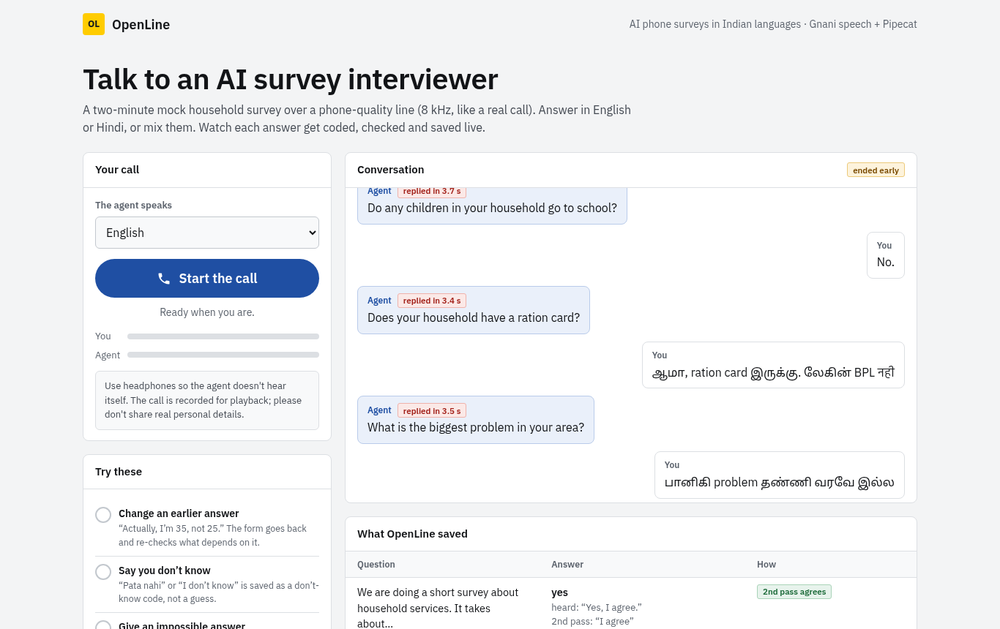
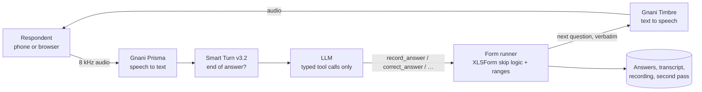
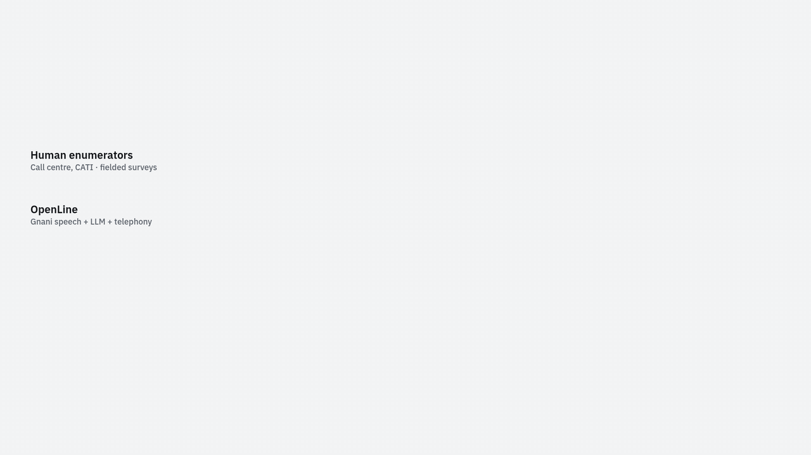

<div align="center">

# OpenLine

**AI phone surveys in Indian languages. Bring the survey form you already have.**

Run an existing XLSForm (ODK, KoboToolbox, SurveyCTO) as a phone interview. Gnani Prisma listens,
an LLM interprets, the form decides, Gnani Timbre speaks, all on Pipecat.




</div>

## Try it

Start the API (see [Quick start](#quick-start)) and open **http://localhost:8000/demo**. Press *Start the call*
and answer a two-minute mock survey over a phone-quality line (8 kHz μ-law, the same pipeline a real call
uses). You see the conversation, each reply delay, and every answer as it's coded. A checklist ticks off
features as you try them: correcting an answer, saying "pata nahi", mixing languages, staying silent.

To share it, run the server with `FORMS_DEMO_ONLY=true` and tunnel port 8000 (`ngrok http 8000`). Only the
demo routes answer then, and at most `FORMS_DEMO_MAX_CALLS` (default 3) calls run at once.

## How it works



**The form decides; the LLM only listens.** The form runner picks the next question and validates every
answer. The LLM can only turn speech into a candidate value through six typed tools, so it can't skip,
reword or answer a question itself.

## Features

| | |
| --- | --- |
|  | **Pipecat Flows, one node per question.** Questions are spoken word for word; skip logic, ranges and corrections (“sorry, I'm 35, not 25”) run in the form runner. Each question starts with a fresh LLM context plus one line of answers so far. |
|  | **Turn detection.** Smart Turn v3.2 decides whether you've finished from the audio itself, and the longest silence it waits depends on the question: 1.2 s for yes/no, up to 3.5 s for open answers. |
|  | **Interruptions.** Two or more words stop the agent; a one-word “haan” while it speaks doesn't. Consent and goodbye can't be talked over. |
|  | **Accuracy checks.** Numbers are checked against the digits in the transcript and read back when they disagree; a read-back needs a real yes. Three invalid answers become “unclear” and go to review. After the call, every answer clip is transcribed again. |
|  | **Code-switching.** With `STT_AUTO_LANGUAGE=true`, Prisma v3.0 listens for English, Hindi and Tamil in one sentence. Hindi–English mixing works reliably over the phone path; Tamil inside a mixed sentence was transcribed right in 1 of 3 live calls so far. |
|  | **Cost.** An estimate against published per-interview costs of human phone surveys; the sources and assumptions are on the slide. |

Also in the box: XLSForm upload with a 14-rule phone check and an editor, versioning, campaigns with retries
and callbacks, resume-on-retry, crash cleanup, backup LLM failover, a review queue, CSV and KoboToolbox export,
and simulated respondents (5 personas, background noise) for testing before any real call.

## Quick start

Needs: Docker, [uv](https://docs.astral.sh/uv/), Node 22+, and the `pipecat-gnani` fork checked out
next to this repo (`../pipecat-gnani`).

```bash
make setup                 # uv sync + npm install; creates apps/api/.env from .env.example
make migrate               # Postgres up + migrations
make dev                   # API http://localhost:8000/docs · UI http://localhost:5173
```

Keys go in `apps/api/.env` (see [`apps/api/.env.example`](apps/api/.env.example)); never commit them.
`GET /api/voice/status` lists what's missing. Use a main and a backup LLM with **different** keys or
providers, so a rate limit on one doesn't stop the call.

| Page | |
| --- | --- |
| http://localhost:8000/demo | Public demo: mock survey with live answers |
| http://localhost:8000/phone-sim | Any form over the 8 kHz phone path, with packet loss |
| http://localhost:5173 | The full app: forms, phone check, campaigns, review, simulations |

Real phone calls also need `ngrok http 8000` (`make dev ARGS=--ngrok`) with `PUBLIC_BASE_URL` set to the
tunnel URL and Twilio keys.

| Command | |
| --- | --- |
| `make test` | Backend tests + web type-check |
| `make smoke` | Live Gnani TTS → STT at 8 kHz, English + Hindi |
| `uv run python scripts/codeswitch_check.py` | Live Prisma check on English/Hindi/Tamil mixed answers (in `apps/api`) |
| `make build` | Production build of the web app |

## Repository layout

```
apps/
  api/            FastAPI backend: XLSForm module, phone check, Pipecat survey bot, telephony, demo
    app/          api/ (routes), xlsform/, checks/, voice/ (runner, flow, bot, calls, second pass), static/
    migrations/   Alembic
    tests/        pytest (SQLite, no Postgres needed)
    scripts/      gnani_smoke, fake_twilio_call, browser_test, codeswitch_check, codeswitch_call
    sample_forms/ public XLSForms, test and trial forms, the demo survey
  web/            React + Mantine UI (forms, inspector/editor, interviews, campaigns, review, simulations)
assets/readme/    images for this README
scripts/dev.sh    start everything locally
```

## Stack

FastAPI · SQLAlchemy 2 · Alembic · Postgres · pyxform · Pipecat 1.x + Flows · Smart Turn v3.2 ·
Gnani Prisma (STT) and Timbre (TTS) · Gemini / Groq · Twilio / Exotel · React · Mantine · TanStack Query.
